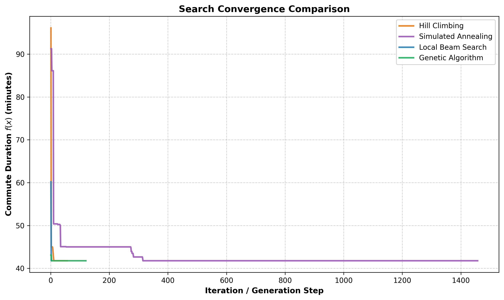

# گزارش تمرین عملی ـ بهینه‌سازی مسیر و ساعت حرکت با جستجوی محلی

## طراحی عملگرها

### همسایه‌ها

`get_neighbors`

۱. ساعت حرکت یک یا دو قدم (۵ یا ۱۰ دقیقه) جلو یا عقب می‌رود، به شرط اینکه داخل بازه بماند.

۲. برای هر دو گره از مسیر، مسیرهای ساده‌ی دیگری که آن دو گره را وصل می‌کنند (حداکثر دو یال بیشتر از بخش اصلی) جای آن بخش می‌نشینند.

۳. همسایه‌های تکراری حذف می‌شوند و هر همسایه آخر کار اعتبارسنجی می‌شود.

**عدم ایجاد دور:** گره‌های قبل و بعد از بخش جایگزین‌شونده ممنوع هستند و داخل مسیر جدید هم گره تکراری مجاز نیست. چون فقط از یال‌های گراف استفاده می‌شود، مسیر همیشه پیوسته هم می‌ماند.

**تعادل ساعت و مسیر:** از ۳۰ همسایه‌ی یک وضعیت، حداکثر ۴ تا تغییر ساعت است. وقتی فقط ±۱ قدم مجاز بود، تبرید شبیه‌سازی‌شده که همسایه را تصادفی انتخاب می‌کند خیلی کم ساعت را عوض می‌کرد و روی یکی از سناریوها ۱.۶۴ دقیقه از بهینه بدتر بود. با ±۲ قدم این فاصله صفر شد.

### ترکیب

`crossover`

۱. از بین گره‌های مشترک دو والد (به جز مبدأ و مقصد)، یکی تصادفی انتخاب می‌شود و فرزند از ابتدای یک والد تا آن گره و ادامه‌ی والد دیگر ساخته می‌شود.

۲. اگر فرزند گره تکراری داشت، گره مشترک بعدی امتحان می‌شود.

۳. ساعت فرزند میانگین ساعت والدهاست که به نزدیک‌ترین ساعت مجاز گرد می‌شود.

۴. اگر ترکیب ممکن نبود، یکی از همسایه‌های والد بهتر برگردانده می‌شود، پس خروجی همیشه معتبر است.

---

## مقایسه‌ی نتایج

میانگین ۳۰ اجرا روی نقشه‌ی ساده و سناریوی «ساعت شلوغی ساده». هر چهار الگوریتم به یک جواب رسیدند که با جستجوی کامل همه‌ی مسیرها و ساعت‌ها هم تایید شد: ۴۱.۷۷ دقیقه با حرکت ساعت ۰۸:۴۵ و مسیر

`Home -> B1 -> B2 -> H2 -> Uni`

| الگوریتم            | بهترین زمان سفر (دقیقه) | میانگین زمان اجرا (ثانیه) | تکرار تا همگرایی | کل تکرارها |
| ------------------- | ----------------------- | ------------------------- | ---------------- | ---------- |
| تپه‌نوردی           | ۴۱.۷۷                   | ۰.۰۵                      | ۷.۹              | ۴۹         |
| تبرید شبیه‌سازی‌شده | ۴۱.۷۷                   | ۰.۳۴                      | ۲۴۱              | ۱۴۵۷       |
| جستجوی پرتویی محلی  | ۴۱.۷۷                   | ۰.۰۳                      | ۲.۹              | ۳.۶        |
| الگوریتم ژنتیک      | ۴۱.۷۷                   | ۰.۵۸                      | ۴.۲              | ۱۲۰        |

«تکرار تا همگرایی» اولین تکراری است که به بهترین مقدار نهایی رسیده. واحد تکرار در الگوریتم‌ها فرق دارد (قدم، همسایه‌ی تصادفی، نسل)، پس فقط تقریبی قابل مقایسه است.

در چهار سناریوی دیگر هم هر چهار الگوریتم در هر ۳۰ اجرا به بهینه رسیدند، به جز یک اجرای ژنتیک روی «ترکیب مسیرها» (۲۹ از ۳۰).

---

## تحلیل نمودار همگرایی

- **تپه‌نوردی:** از ۹۶ دقیقه شروع می‌کند، کمی نزدیک ۴۵ می‌ماند و در حدود ۱۰ قدم به ۴۱.۷۷ می‌رسد. بقیه‌ی خط مربوط به ریستارت‌هاست.
- **تبرید شبیه‌سازی‌شده:** پلکانی پایین می‌آید و حدود ۲۰۰ تکرار روی ۴۵ دقیقه می‌ماند، چون دما بالاست. در تکرار ۳۱۵ به ۴۱.۷۷ می‌رسد.
- **جستجوی پرتویی محلی:** در سه تکرار به ۴۱.۷۷ می‌رسد و متوقف می‌شود. سریع‌ترین است.
- **الگوریتم ژنتیک:** جمعیت اولیه از قبل خوب است (حدود ۴۳) و بعد از ۴ تا ۵ نسل به ۴۱.۷۷ می‌رسد.

**دره‌ی محلی:** مسیر بزرگراه در «ساعت شلوغی ساده» یک دره‌ی محلی است. تپه‌نوردی بدون ریستارت در هیچ‌کدام از ۵۰ اجرا از آن بیرون نیامد. تبرید با پذیرش حرکت بدتر، پرتویی با چند وضعیت هم‌زمان و ژنتیک با جمعیت از آن رد شدند.

**دشت:** در «ترکیب مسیرها» و «ساعت شلوغی دوقله‌ای» همسایه‌هایی با هزینه‌ی برابر پیدا می‌شوند. تپه‌نوردی بدون حرکت کناری در هیچ اجرایی موفق نبود، ولی با حرکت کناری ۳۴ از ۵۰ و ۳۹ از ۵۰ موفق شد.

**قله‌ی ترافیک:** تبرید فقط به کمک دمای بالا از قله‌ها رد می‌شود و این باعث می‌شود تا تکرار ۳۱۵ طول بکشد.

---

## پاسخ به پرسش‌های تحلیلی

### پرسش ۱ ـ گرادیان کاهشی

مسیر یک دنباله‌ی گسسته از گره‌هاست و مشتق ندارد، پس گرادیان کاهشی روی آن معنا ندارد.

برای ساعت حرکت با مسیر ثابت می‌شود از آن استفاده کرد، به شرط اینکه ساعت پیوسته باشد و $C_e(t)$ مشتق‌پذیر باشد (موج گوسی این‌طور است). مشتق زمان رسیدن در هر یال $1 + t_e^{\text{base}} \cdot C_e'(t)$ است و باید نامنفی باشد، یعنی هر کس زودتر وارد یال شود دیرتر خارج نشود. برای رسیدن به کمینه‌ی سراسری باید $f(t)$ محدب هم باشد، که با موج‌های چندقله‌ای نیست.

### پرسش ۳ ـ جستجوی پرتویی و الگوریتم ژنتیک

مزیت ترکیب این است که نیمه‌ی خوب یک مسیر را با نیمه‌ی خوب مسیر دیگر می‌چسباند. پرتو برای این کار باید چند دورزدن پشت‌سرهم انجام دهد که موقتاً بدتر هستند.

بله، پرتوها جمع شدند. در یک پرتو ۸ تایی روی «ساعت شلوغی دوقله‌ای» تعداد مسیرهای متفاوت از ۶ به ۳ و بعد ۲ رسید. ما فقط وضعیت‌های تکراری را حذف کردیم. محدود کردن تعداد اعضای هم‌مسیر یا اضافه کردن وضعیت‌های تصادفی هم می‌تواند کمک کند.

### پرسش ۴ ـ دشت‌ها و حرکت‌های کناری

دشت وقتی پیش می‌آید که دو مسیر جایگزین زمان سفر یکسان داشته باشند. مثلاً در «ترکیب مسیرها» از وضعیت اولیه، عوض کردن `B2` با `T2` هزینه را تغییر نمی‌دهد.

بدون ریستارت، حرکت کناری صفر در دو سناریوی دشتی هیچ موفقیتی نداشت و ۱۰۰ حرکت کناری ۳۹ و ۳۴ از ۵۰ اجرا را موفق کرد. با ۱۰ ریستارت، مقدار ۰ تا ۱۰۰۰ هر ۷۵ اجرا را موفق کرد و فقط زمان از ۰.۰۴ به ۰.۰۶ ثانیه رفت. چون وضعیت‌های دیده‌شده دوباره امتحان نمی‌شوند، دشت‌ها زود تمام می‌شوند و مقدار بالای ۱۰۰ فایده‌ای ندارد.

### پرسش ۵ ـ برنامه‌ی خنک‌سازی

دمای اولیه‌ی بالا تقریباً همه‌ی حرکت‌ها را می‌پذیرد و بودجه‌ی تکرار را هدر می‌دهد. با ۳۰۰ تکرار، دمای ۱۲۰ و ۱۰۰۰ فقط ۱۵ و ۱۳ از ۵۰ اجرا را موفق کردند و دمای ۱ در ۳۷ از ۵۰ موفق بود. با ۳۰۰۰ تکرار هر دو دمای بالا ۵۰ از ۵۰ شدند، ولی دمای ۱ دو بار گیر کرد (۴۸ از ۵۰) چون مثل تپه‌نوردی رفتار می‌کند.

نرخ ۰.۵ بعد از حدود ۱۷ تکرار تمام می‌شود و در هیچ اجرایی به جواب نرسید. نرخ ۰.۹ در ۱۶ از ۵۰ موفق بود. نرخ ۰.۹۹۲ در همه‌ی ۵۰ اجرا موفق بود و در میانگین ۳۹۳ تکرار همگرا شد. نرخ ۰.۹۹۹ هم همه‌ی ۵۰ اجرا را موفق کرد ولی ۷۱۷ تکرار لازم داشت و تمام ۳۰۰۰ تکرار را مصرف کرد.

### پرسش ۶ ـ دو والد جدا از هم و اپیستازی

اگر والدین هیچ گره مشترکی نداشته باشند، تابع ترکیب یکی از همسایه‌های والد بهتر را برمی‌گرداند. پس همیشه یک وضعیت معتبر بیرون می‌آید و فقط ترکیب انجام نمی‌شود.

اپیستازی به این دلیل است که کیفیت هر نیمه‌ی مسیر به ساعتی که به آن می‌رسیم بستگی دارد. نیمه‌ی دوم والد ۲ فقط وقتی سریع است که زمان رسیدن به گره‌ی مشترک در بازه‌ی خلوت باشد. بعد از ترکیب، این زمان عوض می‌شود و ممکن است درست به موج ترافیک بخورد، پس دو نیمه‌ی خوب می‌توانند فرزند بسیار بدی بسازند.
